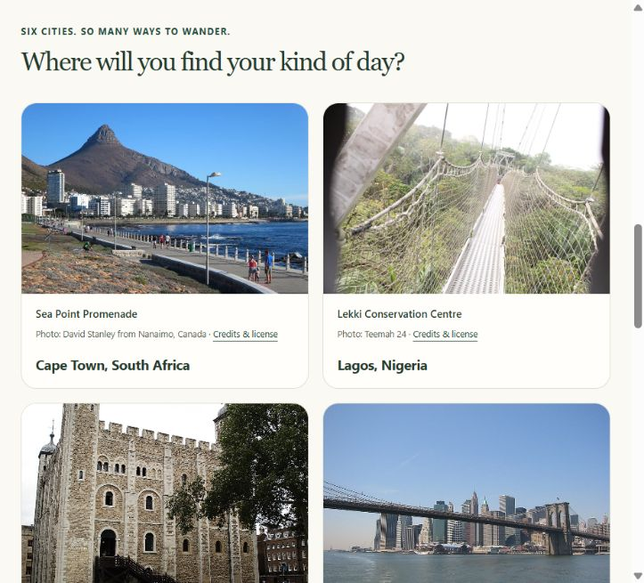

# TripPlanner

A local-first travel planner built for an AI Programming class. Choose a city, allowance, interests, and pace; get explained recommendations, a daily itinerary, and saved trip snapshots.

**Version:** 0.8.0-demo.2 · **Original code:** [MIT](LICENSE) · **Coverage:** six curated cities · **AI:** explainable rules and scheduling

**Live classroom demo:** [tripplanner-mayowa.onrender.com](https://tripplanner-mayowa.onrender.com/) · [GitHub source](https://github.com/adeniyimayowa003-byte/TripPlanner). Free hosting can sleep between visits; allow about a minute for waking.

**Verification:** **1,688 pytest cases passed**, including 92 hosting checks with real PostgreSQL and disposable backup/restore. [Verified GitHub CI](https://github.com/adeniyimayowa003-byte/TripPlanner/actions/runs/42194166693) passed on Windows, Linux and PostgreSQL. On 6 November 2026 the live browser journey verified preferences, recommendations, itinerary, saving/reopening, photographs and Light/Dark. An actual Render service restart preserved the rehearsal snapshot exactly, retained the original browser's access, and continued to deny another visitor with the same 404 as a missing trip. See [restart evidence](docs/hosted-restart-check-2026-11-06.md), [submission status](docs/submission-status-2026-11-06.md) and [hosting instructions](docs/free-demo-hosting.md). Native demo.2 binaries below retain their earlier recorded verification.

**Earlier native-release verification:** all 1,596 pytest cases passed at that checkpoint. The extracted Windows demo passed planning/save/theme/restart/Maps checks on the recorded Windows 11 host. The Android debug APK passed the recorded offline/native-tap, restart, and appearance checks on an Android 15 x86_64 emulator. A physical phone remains untested. See the [final release report](docs/final-release-checks.md).



[Dark-mode screenshot](docs/images/tripplanner-dark.png) · [Photo credits](PHOTO_CREDITS.md) · [Privacy](PRIVACY.md)

## What works

- Paris, Lagos, London, New York City, Tokyo, and Cape Town, with 48 sourced places.
- Destination currencies: EUR, NGN, GBP, USD, JPY, and ZAR. Changing currency requires review; no exchange-rate conversion is performed.
- Personalized recommendations with a reason for each match, exact allowance checks, and useful empty results.
- Daily itineraries without repeated places, combined daily cost checks, and honest unfilled slots.
- Immutable local saved trips that retain the reviewed ideas and estimates, including historical snapshots.
- Google Maps buttons opening each public venue separately, with no API key.
- Light, Dark, and Use device setting, plus 18 credited local photographs and graceful image fallbacks.
- A Windows x64 portable demo build process, separate app storage, and native appearance persistence.

The classroom handoff includes Windows and Android demos, a 17-slide PowerPoint with notes, and a 16-page Word presentation guide. See [PLAN.md](PLAN.md) and the [presentation walkthrough](docs/presentation-walkthrough.md). Other Windows hosts, physical Android phones, and public-store release remain outside the recorded verification.

## Run the website

For the public classroom demo, open [TripPlanner online](https://tripplanner-mayowa.onrender.com/). The instructions below run the **local preview**, which needs the computer and Python process to stay on. The hosted website runs separately with protected anonymous collections and PostgreSQL storage. Follow the [free hosting guide](docs/free-demo-hosting.md) for its configuration and remaining verification limits. Do not expose the development preview or upload its database.

Use Python 3.14. Node 24 is needed for development JavaScript tests, not to run the website.

```powershell
python -m venv .venv
.\.venv\Scripts\Activate.ps1
python -m pip install -r requirements-dev.txt
python app.py
```

Open [TripPlanner locally](http://127.0.0.1:5000/). Keep the server running while using the page. A refused connection usually means the local server is not running; the static source files alone do not run Flask. If PowerShell activation is restricted, invoke `.venv\Scripts\python.exe` directly instead of changing your system policy.

For a runtime-only install, use `requirements.txt`. It contains Flask; tests and native build tools are separated into development/Windows requirement files. Optional local environment examples are in [.env.example](.env.example); the app does not automatically load that file. Never commit real secrets or saved data.

## Windows download

The portable artifact is generated under `dist/release/` with a matching `.zip.sha256` file. Extract the **whole ZIP**, then open `TripPlanner.exe` with its `_internal/` and `licenses/` folders beside it. End users do not need Python, an editor, or the development server.

Microsoft Edge WebView2 Runtime and Windows .NET Framework are prerequisites. The current artifact is an **unsigned class-project demonstration**. Follow your device's software policy; do not bypass Windows security warnings. The [Windows guide](docs/windows-download.md) records build/launch evidence, platform limits, and the actual artifact checksum.

The native app keeps settings, appearance, browser profile, and saved trips separately under `%LOCALAPPDATA%\TripPlanner`. An absolute `--data-dir` option supports isolated QA profiles. Closing/reopening preserves saved trips and the selected theme. Deleting or clearing that profile can remove its collection.

To build on Windows x64, use a separate `.venv-windows`, the pinned [Windows requirements](requirements-windows.txt), and [tested dependency lock](requirements-windows.lock.txt). Follow the [build instructions](docs/windows-download.md), then run `build_windows.py`. The builder stages an explicit file allowlist and refuses to overwrite an existing ZIP of the same version.

## Android download and presentation

The debug-signed Android demo is `dist/release/TripPlanner-0.8.0-demo.2-android-demo.apk` with a matching checksum. It contains Python and runs the local planner on-device. It targets Android 10+ with ARM64/x86_64 libraries. The recorded Android 15 x86_64 emulator journey covers offline planning, saving, photos, native Back, Maps intent routing, restart persistence, and device/manual appearance. Physical phones remain untested. Follow the [Android guide](docs/android-download.md) and [actual evidence](docs/phase-08-android.md).

The editable 17-slide PowerPoint and 16-page Word presentation guide are in `dist/presentation/`. They include actual app screenshots, travel photos, summarized specifications/plans, AI explanations, speaker notes, a demonstration script, teacher Q&A, and photo credits. See the [presentation walkthrough](docs/presentation-walkthrough.md). Download binaries and presentation files belong in reviewed release assets; `dist/` stays excluded from ordinary source commits.

## Test and review

```powershell
python -m pytest -q
python release_checks.py
```

Tests use temporary databases/profiles, never your real collection. Node executes the actual appearance, planner, and photo-error scripts without npm packages. Git is needed for the independent ignore-rule check. On Windows, `python -X utf8 -m pytest -q` can make output encoding explicit.

[GitHub Actions](.github/workflows/tests.yml) is configured to test on Windows and Linux after upload. A configured workflow is not a claim that hosted CI has already run. See [CONTRIBUTING.md](CONTRIBUTING.md) for the specification-first workflow and private-file rules.

## How the AI works

An idea qualifies when it is in the selected city, matches an interest, and fits the exact per-day allowance. Matching interests earn three points each; supported pace/family-friendly tags add one point each. Ties use lower cost, name, and stable ID. Cards explain their matches.

The greedy scheduler spreads eligible places across days, checks combined daily costs, and never repeats a place just to fill a gap. Money uses Decimal on the server; the browser preview uses integer minor units. This is rule-based personalization, not a trained machine-learning model or autonomous chatbot.

Costs, dates, and time slots are illustrative. Flights, accommodation, transport, and missing meals are excluded. Live prices, bookings, opening hours, routes, accessibility, dietary requirements, and comprehensive suitability are not verified. Coverage is the six bundled cities, not worldwide live search.

## Privacy, offline use, and licensing

Core planning, bundled photos, credit metadata, and local saves use local data. Google Maps, venue sources, photographer profiles, and license deeds open externally and need internet. There are no accounts, ads, analytics, GPS tracking, payments, or automatic trip uploads.

The web collection is shared by browsers using that server/database. The Windows collection belongs to the chosen OS/profile folder; other people using that same profile can see it. Local storage is not application-level encryption. See [PRIVACY.md](PRIVACY.md).

Original code is [MIT licensed](LICENSE). Photographs retain their individual licenses in [PHOTO_CREDITS.md](PHOTO_CREDITS.md). Dependencies retain their licenses in [THIRD_PARTY_NOTICES.md](THIRD_PARTY_NOTICES.md) and the download's `licenses/` folder. Keep those notices when redistributing.

Before the first GitHub push, review the files being committed. `.env`, saved databases, profiles, virtual environments, caches, `.tmp`, and build outputs are ignored. Publish reviewed ZIPs as release assets, not ordinary source files. This local preparation does not create or upload to a GitHub repository.

## Understand the project

| Area | Responsibility |
| --- | --- |
| `app.py`, `templates/`, `static/` | Routes, forms, accessible pages, photos, and themes |
| `catalog.py`, `data/` | Reviewed city/place data and licensed-image metadata |
| `preferences.py`, `currencies.py`, `money.py` | Validated inputs and exact native-currency money |
| `recommendations.py`, `itinerary.py` | Explainable ranking and daily scheduling |
| `drafts.py`, `csrf.py`, `currency_context.py` | Session drafts and protected/reviewed forms |
| `snapshots.py`, `saved_trips.py` | Frozen historical results and SQLite storage |
| `photos.py` | Exact-place photos, honest city fallbacks, and credits |
| `app_runtime.py`, `windows_app.py` | Owned local service, per-user storage, and native window |
| `build_windows.py`, `release_checks.py` | Allowlisted packaging and source-publication checks |
| `tests/`, `specs/`, `plans/`, `docs/` | Test-first evidence, approved scope, and student guides |

Start with the [web flow guide](docs/phase-08-three-phases.md), [photo guide](docs/phase-08-photos.md), and [Windows guide](docs/windows-download.md). Earlier phase guides explain the recommender, scheduler, saved snapshots, and appearance increment in smaller steps. The project has no fixed weekly timeline.
