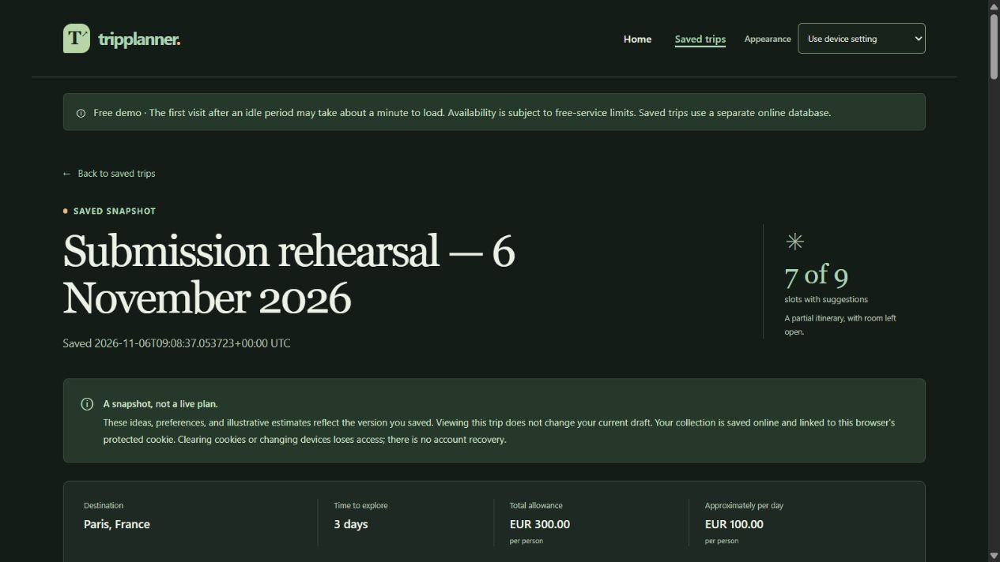

# Actual hosted restart check — 6 November 2026

**Result: passed for the recorded rehearsal snapshot.** The existing Render Free service was deliberately restarted through its signed-in dashboard. The original browser reopened its saved trip, the database row stayed exactly unchanged, and an unrelated HTTP visitor remained unable to access it.

## Operator action

- Service: `tripplanner-mayowa`, Frankfurt, Free; [public website](https://tripplanner-mayowa.onrender.com/).
- Dashboard action: **Manual Deploy → Restart service**. No new build, paid upgrade, secret rotation or storage change was performed.
- Render's Events page recorded **“Service restarted by you”**, **6 November 2026 at 5:37 PM** in the dashboard's displayed time (09:37 UTC).
- The deployed application commit remained `b969af3b575b3827ec08b51976e812044f38e100`. A later documentation commit on GitHub does not change the already-deployed application.

## Before and after

Only the explicitly created QA snapshot, **Submission rehearsal — 6 November 2026**, row 1, was read for this comparison. No other visitor collections were inspected or modified. Its original saved time is `2026-11-06T09:08:37.053723+00:00`.

| Check | Before restart | After restart |
| --- | --- | --- |
| Check time, UTC | 09:37:13 | 09:38:50 |
| Expected QA row count | 1 | 1 |
| Public `/healthz` | HTTP 200, `{"status":"ok"}` | HTTP 200, `{"status":"ok"}` |
| Database client TLS | Verified certificate/hostname, TLS active | Verified certificate/hostname, TLS active |
| Same browser opening saved trip | Correct title, time and itinerary | Correct title, time and itinerary |
| Visitor without owner cookie | HTTP 404 | HTTP 404 |
| Foreign response vs nonexistent trip | Identical body; no saved title | Identical body; no saved title |

The SHA256 digest of the canonical serialization of the complete selected row (`id`, owner digest, title, creation time, fingerprint and snapshot JSON) matched exactly before and after:

```text
01f2da04d66fa895a538f370bf58325791403064a04673fa448dc045bf66d40c
```

Private credentials, the owner value and cookie values are excluded from this report. The private local verification record is excluded from source publication.

After reloading the actual saved page, the browser showed the same saved time, ten loaded images, fourteen external Maps links and the original **Use device setting** appearance preference. These are DOM/browser observations, not a claim that Google Maps itself was opened during this restart check.



## Meaning and limits

The test demonstrates that this committed snapshot and the original browser's access survived an actual provider restart with the existing stable signing secret and remote database. Browser refresh and the earlier observed free-service wake-up were not substituted for the operator restart event. This was a restart of the deployed version, not a fresh build/redeploy test, destructive recovery drill, load test or uptime guarantee.

The source suite's 1,688 local passes and the [verified Windows/Linux/PostgreSQL CI run](https://github.com/adeniyimayowa003-byte/TripPlanner/actions/runs/42194166693) provide broader regression evidence. Free hosting still sleeps and has quotas. Rehearse on the actual presentation device; physical Android and arbitrary Office versions remain outside the recorded checks.
