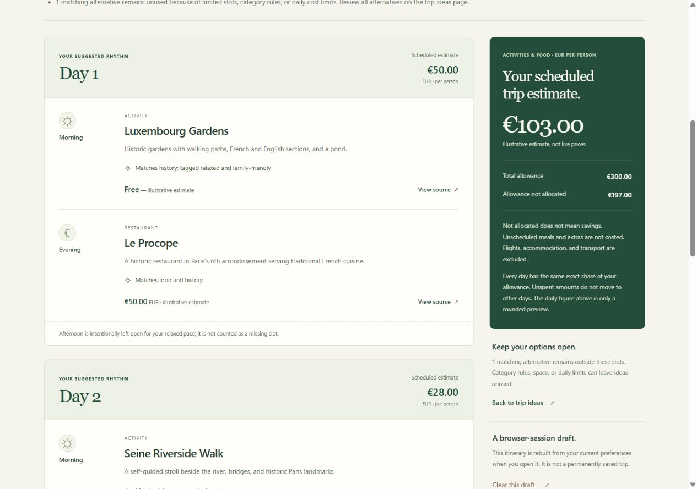

# Phase 5 — Implementation and Verification

**Status:** Complete for the approved daily-itinerary increment.

**Scope:** [Approved specification](../specs/phase-05-itinerary.md), [implementation/test plan](../plans/phase-05-itinerary-plan.md), and [student learning guide](phase-05-learning.md).

## What now works

The current journey is **preferences → trip ideas → Build my daily itinerary → review days → back/edit/clear**. The itinerary link also works when no recommendations qualify.

- Every requested day has its own section, including days with no suggestions.
- Relaxed uses Morning/Evening; no preference uses Morning/Afternoon/Evening. Current Paris data still does not offer active pace.
- Suggestions are allocated across days in slot-major order. Restaurants are evening suggestions; fallback attractions/activities retain their real category.
- No catalog ID is repeated, and candidates skipped for affordability remain available for later days.
- Combined daily costs use exact decimal comparisons, not the rounded preview. Daily and trip estimates and unallocated allowance are visible.
- Gaps, missing meal coverage, unused alternatives, and unconfirmed scheduled preferences are explained honestly.
- Read-only `/itinerary` regenerates from the validated session draft and current catalog. No generated itinerary payload is stored in the cookie.
- Existing navigation, invalid-edit preservation, session isolation, and CSRF-protected clearing continue working.

## Changes and responsibilities

| File | Implemented responsibility |
| --- | --- |
| [itinerary.py](../itinerary.py) | Independent scheduling, exact totals, no repeats, and evidence-based limitation notices. |
| [app.py](../app.py) | A GET-only itinerary route reusing the existing draft/catalog validation path. |
| [itinerary template](../templates/itinerary.html) | Semantic day/slot sections, matching details, costs, caveats, and working controls. |
| [recommendations template](../templates/recommendations.html) | An always-available link to build the daily itinerary. |
| [stylesheet](../static/css/style.css) | Scoped day-card, summary, and responsive styling consistent with the existing green-and-paper design. |

No dependency, catalog, recommendation score, draft schema, database, account system, or external AI service was added or changed for this increment.

## Automated verification

The testing gate was completed before implementation: **322 cases collected, 245 passed, 77 expected missing-feature failures**. The [red checkpoint](phase-05-testing.md) preserves the detailed evidence.

After implementation and the final presentation refinements, the full suite passed **322 cases**, with no failures, errors, or skipped tests. All 12 test/fixture files retain their pre-implementation SHA-256 hashes: no assertion was removed, disabled, or weakened to obtain green results.

| Area | Passing cases |
| --- | ---: |
| Existing validation, recommendations, drafts, form, home, and security cases | 244 |
| Itinerary domain cases | 37 |
| Itinerary integration cases | 41 |
| **Total** | **322** |

The ignored local machine-readable result is `.tmp/phase5-green.xml`. Test execution used a fresh, validated base directory inside the project's `.tmp` folder to avoid the Windows default temporary-folder restriction. The [testing report](phase-05-testing.md#safe-reproduction) explains the safe command pattern.

The checks cover exact cumulative rounding boundaries, skip-not-discard behavior, restaurant priority and fallback, category rules, unique IDs, input preservation, scheduled-only preference evidence, all sample totals, route recovery, edits, catalog changes, sessions, and actual form tokens.

## Real-browser verification

The actual local Flask app was checked in the in-app browser; Python test-client results were not treated as proof of layout or keyboard behavior.

| Check | Observed result |
| --- | --- |
| Relaxed sample: Paris, 3 days, EUR 300, food/history, family-friendly | Six suggestions in six requested slots; daily estimates EUR 50/28/25, trip EUR 103.00, unallocated EUR 197.00. Day 3's Louvre fallback stays an attraction, not a meal. |
| Remove pace | Seven unique ideas in nine slots; trip estimate EUR 135.00. |
| EUR 60, relaxed | Three free Morning ideas, three unfilled Evenings, EUR 0.00 scheduled, with missing-meal and partial-result explanations. |
| Food only, EUR 1, 14 days | No-match recommendations still link to an itinerary with all 14 sections, 0 of 28 filled slots, EUR 0.00 scheduled, and edit recovery. |
| EUR 100.01 over 3 days | Approximate daily EUR 33.34, scheduled EUR 85.00, unallocated EUR 15.01; the individual daily cap excludes Le Procope. Unit fixtures independently verify the combined-cost cent boundary. |
| Invalid edit: 0 days | Associated error summary displayed and the entered budget retained. The last valid EUR 85.00 itinerary remained available. |
| Refresh | The valid itinerary remained available without resubmitting the preferences form. |
| Keyboard | Enter activated back/edit/submit/build/clear; native pace selection worked with Home/End. Tab focus showed a solid 2.4px outline on the checkbox. |
| Clear and direct navigation | Clear returned to blank preferences with confirmation. Opening `/itinerary` afterward redirected to the planner with useful missing-draft feedback. |
| Normal-flow browser errors | No console errors observed. External source links were not needed or visited. |

### Responsive layout

The browser's real viewport override was applied and measured, rather than inferred from HTML or a resized screenshot:

- At **360 × 800**, content width and scroll width were both 345px after the vertical scrollbar. Day cards stacked in one column with readable slots and no horizontal overflow.
- At **1280 × 900**, content width and scroll width were both 1265px. The itinerary used a two-column day-list/estimate layout with no horizontal overflow.
- Day/slot headings, estimates, gaps, and actions were inspected visually. Temporary viewport overrides were reset after checking.

### Application scripts blocked

A temporary copy of the real app on port 5001 added `Content-Security-Policy: script-src 'none'` and used a separate test cookie. This blocks application scripts; it is not a claim that the browser's global JavaScript setting was disabled.

The instant form preview stayed at its placeholder, while submission → recommendations → itinerary produced EUR 103.00. Back/edit prefilled the preferences, changing the budget to EUR 60 produced EUR 0.00, and clearing returned to blank fields. The temporary tab and test server were closed afterward. The main local TripPlanner preview remains available for the user.

## Scope and limitations

The scheduler is a simple explainable greedy rule, not an optimized route, a trained model, or an autonomous AI agent. It does not verify opening hours, durations, dates, transport time, availability, dietary requirements, or live prices. A suggested Evening does not establish that a venue is open then.

Only scheduled ideas are costed. Missing meals, extra activities, flights, accommodation, and transport can still cost money; unallocated allowance is not guaranteed savings. Preferences are soft ranking evidence, not suitability guarantees. The small seven-item Paris catalog can produce many gaps on longer trips, and these gaps are intentional rather than filled with repeated or invented places.

Permanent SQLite saving remains later work. This increment is a browser-session draft experience, not durable trip storage.

## Student handoff

Read the [learning guide](phase-05-learning.md) for the request flow, algorithm explanation, six small practice tasks, and a presentation talk track. Start by predicting the EUR 103.00 sample, then remove pace or lower the allowance and explain the changed result before running it.

