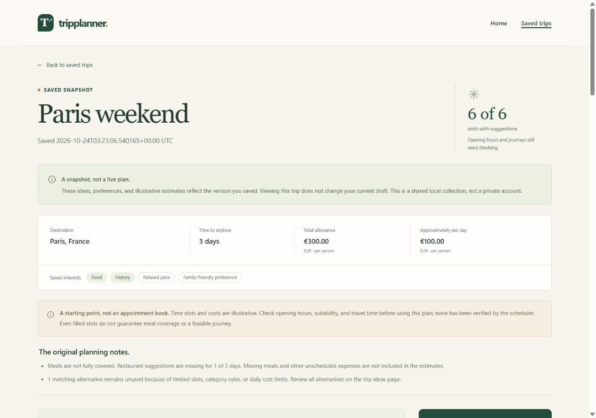

# TripPlanner — Phase 6 Implementation and Verification

**Outcome:** Save this itinerary, Saved trips, and read-only historical details are implemented locally. All **676 pytest cases pass**; the required browser journeys, responsive checks, script-blocked flow, restart persistence, and catalog independence were verified.

**References:** [Approved specification](../specs/phase-06-saved-trips.md), [implementation/test plan](../plans/phase-06-saved-trips-plan.md), [historical red checkpoint](phase-06-testing.md), and [student guide](phase-06-learning.md).

## What changed

- [snapshots.py](../snapshots.py) owns complete versioned payloads, exact money serialization/validation, safe names, canonical JSON, and content fingerprints. It does not load current catalog data when reading saved content.
- [saved_trips.py](../saved_trips.py) owns lazy SQLite storage, schema checks, UTC metadata, transactions, uniqueness, ordered reads, per-record corruption isolation, and normalized storage failures.
- [app.py](../app.py) adds configuration, the protected POST, saved list/detail, bounded ID checks, friendly recovery, and catalog-independent shared context for saved paths.
- The current itinerary adds a labeled optional name, separate CSRF/content tokens, shared-local disclosure, retained validation errors, and saving. New templates display the collection, read-only details, and recovery.
- [_itinerary_days.html](../templates/_itinerary_days.html) preserves the existing day/slot markup for both current and historical views. Scoped styles retain the green-and-paper design, wrap long titles, and keep navigation usable on narrow screens.
- `.gitignore` now excludes `instance/`, including SQLite journals. README and the student guide document local storage, privacy, behavior, concepts, and practice tasks.

No new dependency, paid API, destination, recommendation/scheduling rule, account, deletion, rename, export, hidden restore, or AI-training behavior was added. The Sites skill's local-only guidance preserved the existing Flask checkout/design; no hosting registration or publication occurred.

## Test-first evidence and final results

The approved test-definition checkpoint came first: **670 collected, 333 passed, 337 expected missing-feature failures, zero errors/skips**, with the application unchanged. Implementation followed that gate.

Final full-suite result: **676 passed in 17.44 seconds**, zero failed/errors/skipped, on the final rerun after browser checks. The run used a fresh validated directory under ignored `.tmp/`; storage fixtures never used the real collection. Machine-readable evidence: `.tmp/phase6-implementation.xml`.

| Area | Passing cases |
| --- | ---: |
| Retained Phase 5 suite | 322 |
| Snapshot unit tests | 194 |
| SQLite repository tests | 59 |
| Saved-trip HTTP integration tests | 101 |
| **Total** | **676** |

These are parameterized cases, not separate features. The saved-flow plus retained itinerary-flow subset also passed all 142 cases. All 10 Jinja templates compiled.

### Narrow test corrections and additional review checks

Two Phase 6 snapshot-test parameter paths were corrected after implementation made their later assertions reachable:

1. The attempted removal of preference tags originally targeted Le Procope, which already had no tags. The corrected case removes tags from Luxembourg Gardens while retaining its claimed matches: genuine corruption rather than a no-op. Correct code cannot reject an unchanged valid sample.
2. Malformed zero-cost money spellings now target the actual free Gardens record, rather than the EUR 50 restaurant. This preserves numeric value so inconsistent sums cannot conceal an overly permissive parser.

No requirement or retained assertion was removed. Thirteen test/fixture files are byte-for-byte unchanged from the implementation-start fingerprints; only the two domain test files received these documented corrections/additions.

Six additional cases were added during review:

- Two check that the builder rejects fractional-cent float/Decimal catalog costs. The implementation already satisfied the approved general exact-money rule by their first execution; these first runs passed, and are **not** presented as red evidence.
- One forces a first-save interleaving: writer A creates the empty SQLite file but pauses before its transaction; writer B must not misclassify it as damaged storage. Three more inject connection-close failures. All four first failed for the reproduced defects before production fixes; evidence: `.tmp/phase6-storage-fault-red.xml`. All now pass.

The initialization fix releases its SQL lock while briefly waiting for another creator to finish, within the configured timeout. It never initializes a pre-existing empty/damaged file as a reset. SQLite uniqueness/transactions remain authoritative across writers. Connection-close failures now become the same safe storage-unavailable exception instead of leaking a raw database exception.

## Actual browser checks

Verification used an isolated localhost preview on port 5001 with a unique test database below `.tmp/phase6-browser-…`, a distinct cookie name, and no use of the user's default collection. Only real browser controls were used for journeys; DOM inspection read visible content/layout. The real catalog file was not changed.

| Check | Observed result |
| --- | --- |
| Empty collection | Truthful No saved trips yet state, shared-local disclosure, working Start planning. |
| Sample save | Paris/3 days/EUR 300/food-history/relaxed/family saves as Paris weekend: all seven ideas, six slots, EUR 103.00 total, EUR 197.00 unallocated. |
| Validation | 81-character name returns its full input and an associated 80-character error. |
| Keyboard | Tab reaches Save this itinerary with a visible 2.4px solid focus outline; Enter saves. Back/View/Plan another links also work by keyboard. |
| Names/duplicates | Blank title becomes Paris, France — 3-day trip. Repeating Paris weekend reuses `/trips/1` and says This trip is already saved. |
| Literal HTML title | `<script>alert("trip")</script>` displays literally; no script element containing the payload or JavaScript dialog appears. |
| Partial/empty | EUR 60 saves 3/6 slots, three gaps, zero scheduled estimate. Food-only EUR 1 over 14 days saves 0/28 with all 14 day sections and missing-meal limitations. |
| Stale form | A second tab changes the draft to EUR 60; submitting the old EUR 300 form gives review guidance, not another saved row. |
| Clear versus save | Clearing the current draft returns a blank planner. Six existing test snapshots remained; the original EUR 103 detail still opened. |
| Read-only detail | Seven original recommendation cards, three day sections, stored total, and no mutation forms. Plan another preserves current answers until explicitly edited/cleared. |
| Mobile 360×800 | Header, save controls, collection, and detail remain usable; 80-character unbroken title wraps. Document client/scroll widths both 345px. |
| Desktop 1280×900 | Collection uses readable two-column cards; long title remains contained. Client/scroll widths both 1265px. |
| Console | No errors during the ordinary save/list/view/clear flow. |

### Scripts blocked, restart, and unavailable catalog

The isolated server was restarted with the **same database**, a **different signing secret**, and the response header `Content-Security-Policy: script-src 'none'`. The saved EUR 103 detail still contained all seven ideas, while the planner no longer depended on the old signed draft.

The allowance preview remained `—`, confirming application scripts did not run. Preferences → recommendations → itinerary → named save → collection → reopen still worked using ordinary server forms and links. This verifies application scripts blocked, not a claim that the browser's global JavaScript setting was disabled. Blocking the optional preview script is intentional, not an app logic error.

The isolated server was restarted again with the same database, another secret, scripts blocked, and its catalog loader deliberately raising `FileNotFoundError`. The original saved page still showed Paris weekend, all seven ideas, and EUR 103.00. The collection listed all seven test snapshots; malformed saved IDs showed friendly recovery with a working link back. No live catalog read was needed. Pytest separately covers removed destinations, missing/unreadable catalog files, malformed draft preservation, and saved 409/503 rendering.



## Data protection and handoff

- The real default `instance/tripplanner.sqlite3` did not exist before this work and remains absent after verification. No real saved collection was reset, deleted, or populated with test trips.
- The isolated test server and its two temporary browser tabs were closed after verification. Its temporary evidence/database remain under ignored `.tmp/`, not mixed into the user's collection. No material data was deleted.
- The normal user-facing preview at `http://127.0.0.1:5000` was refreshed by restarting only its verified project-owned Python processes. `/trips` returns 200, and port 5001 no longer has a listener. The main preview remains running for the user.
- Restarting without a configured stable signing secret can reset **unsaved** browser drafts; this was disclosed before restart. Durable saved trips do not rely on that secret.
- Temporary viewport overrides were reset. The user's other existing browser tab was not closed or edited.

## Reproduce the checks safely

After activating the virtual environment, normally run `python -m pytest`. If the Windows default temporary directory is restricted, run from the project directory with a new base:

```powershell
$phase6Project = (Resolve-Path -LiteralPath '.').Path
$phase6Base = [System.IO.Path]::GetFullPath((Join-Path $phase6Project ('.tmp\phase6-check-' + [guid]::NewGuid().ToString('N'))))
if (-not $phase6Base.StartsWith(($phase6Project + '\.tmp\'), [System.StringComparison]::OrdinalIgnoreCase)) { throw 'Unexpected test directory.' }
if (Test-Path -LiteralPath $phase6Base) { throw 'Choose a fresh test directory.' }
.\.venv\Scripts\python.exe -m pytest -q --tb=short --basetemp $phase6Base
```

Never use an existing data/evidence directory or the workspace root as pytest's base; pytest can clear its base directory. Never delete the real saved collection to make a test pass.

## Remaining limits

This is shared local storage without accounts, authorization, or encryption. Keep the demo bound to localhost and avoid sensitive titles. The collection has no deletion/rename/export interface in this increment. SQLite is not a backup service; keep a copy before manual maintenance.

The project still uses seven illustrative Paris records and explainable recommendation/scheduling rules, not live travel data or a trained model. Opening hours, travel time, meals, bookings, and full-trip feasibility are not guaranteed. Saved estimates remain historical; saving does not improve the model.

The [learning guide](phase-06-learning.md) explains each concept and supplies the six practice tasks and presentation explanation. Later features begin a new specification-approval cycle, without a fixed timeline.
